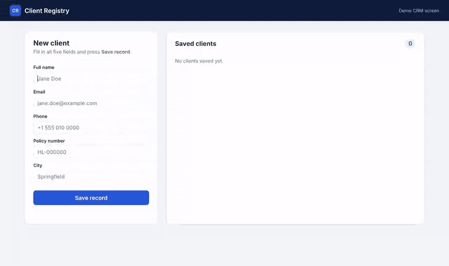
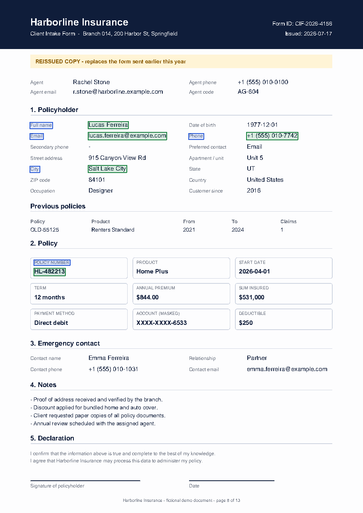
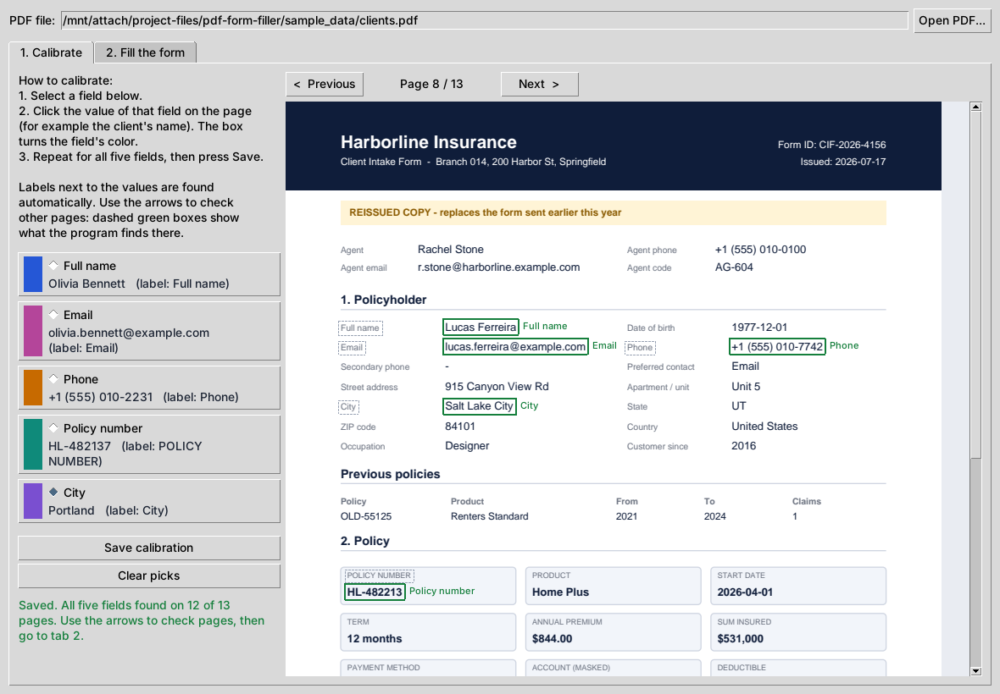
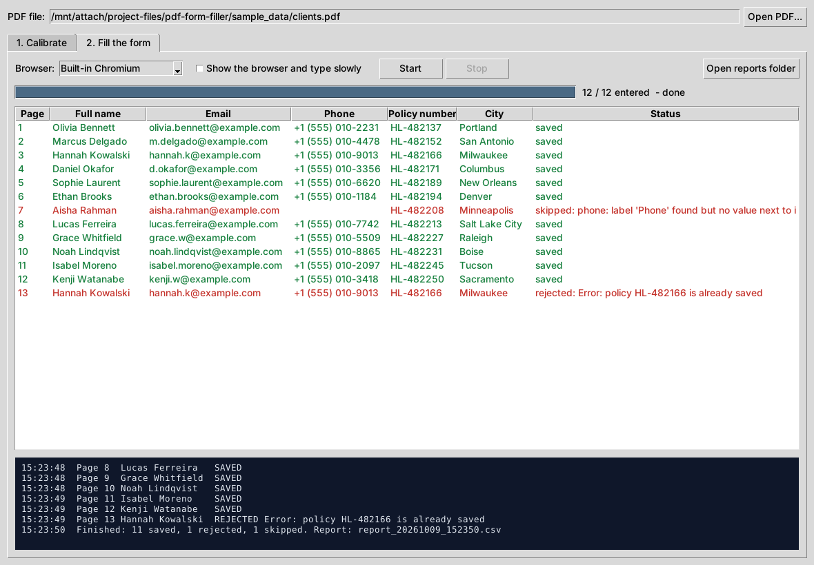
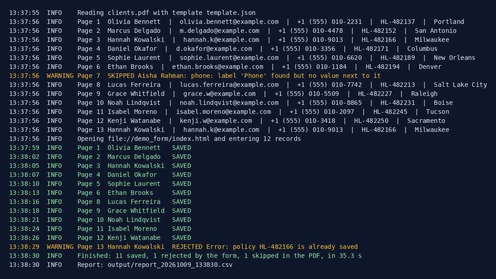
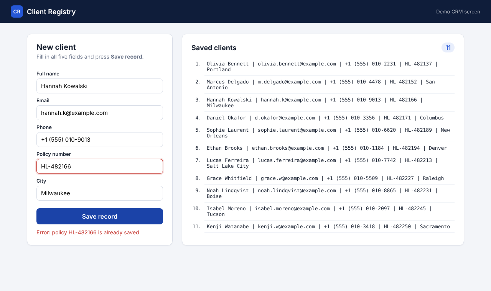

# PDF to Web Form Automation (Python)

A Python tool that reads client records from PDF documents and types them into a web form, one client after another. You teach it once by giving example values from one page; after that it finds the same fields on every other page, even when the layout shifts, and enters them for you.



## What's in the Repository

The project comes in two forms: a ready Windows program and the Python source code it is built from. The repository holds the source code; the program is a zip file on the [Releases](../../releases) page.

```text
pdf-form-filler/
├── src/                       Python source code
├── screenshots/               images and video for this README
└── README.md
```

| | [Windows program (.exe)](#windows-program-exe) | [Python code](#python-code) |
| --- | --- | --- |
| Where | `PDF-to-Web-Form.zip` on [Releases](../../releases) | `src/` folder |
| For whom | Users who just want to run it | Developers who want to read, change or extend it |
| Needs | Windows 10/11 with Edge or Chrome | Python 3.10+ and the packages from `requirements.txt` |
| Interface | Desktop window | Desktop window (`app.pyw`) and command line (`main.py`) |

## The Problem

A company receives client intake forms as PDFs. Each page has around 40 values (agent details, address, policy terms, emergency contact, notes), but the CRM needs only five of them: full name, email, phone, policy number and city. Someone opens every PDF, hunts for those five values, copies them into the CRM one by one and clicks Save.

Simple text parsing does not work well here:

- Pages are not identical. A "reissued copy" banner, a table of previous policies or longer notes push everything down, so fixed coordinates miss.
- There are look-alike values. Every page also has the agent's email and phone and an emergency contact's email and phone. A rule like "take the first email on the page" picks the wrong one.
- Some pages are incomplete, and some clients are sent twice.

## The Solution

**1. Setup by example.** Run `setup`, look at one sample page and type the five values as you see them (for example `Olivia Bennett`, `HL-482137`). The program:

- finds each value on the page;
- finds the label that belongs to it: text on the same line to the left (`Email  olivia.bennett@example.com`) or right above it (a boxed `POLICY NUMBER` field). Labels are recognised as text that repeats on most pages, while data changes from page to page;
- learns the shape of the value: email, phone, date, plain text, or a code pattern such as `[A-Z]{2}-\d{6}` from `HL-482137`;
- saves everything to `template.json`. No coding is needed to adapt it to a new document type.

**2. Extraction.** On every page the program finds the label again (fuzzy matching, so small wording differences are fine), reads the value from the same relative place and checks it against the learned shape. Pages with a missing or wrong-looking value are skipped and listed, not typed.

**3. Form filling with Playwright.** For each complete record the browser fills the five inputs, clicks **Save record** and then reads the page to confirm the client appeared in the "Saved clients" list. If the form shows an error (for example a duplicate policy number), the record is marked as rejected and the bot moves on.

**4. Report.** Every run writes `output/report_<time>.csv` with each page's values and status (`saved`, `rejected`, `skipped`) plus a log file in `logs/`.

The target is a local demo page, [`src/demo_form/index.html`](src/demo_form/index.html) with [`style.css`](src/demo_form/style.css): five fields, input validation, duplicate check, and a list where every saved client appears as one line of text.

`preview` draws what the template found on any page, which makes it easy to check a new template before a big run. Labels are blue, values green (red if a value fails the check):



## Windows Program (.exe)

The ready program is published on the [Releases](../../releases) page as `PDF-to-Web-Form.zip` (about 80 MB download, 200 MB unpacked). Python does not need to be installed.

**How to start:**

1. Download `PDF-to-Web-Form.zip` from the latest release and unpack it anywhere, for example to the Desktop. Do not move the exe out of the unpacked folder: it needs the `_internal` folder and the files next to it.
2. Double-click `PDF-to-Web-Form.exe`.
3. The program opens with the sample PDF (`sample_data/clients.pdf`) already loaded, so you can try it straight away.

**Folder contents:**

| File / folder | What it is |
| --- | --- |
| `PDF-to-Web-Form.exe` | The program itself |
| `_internal/` | Python runtime and libraries bundled by PyInstaller (do not change) |
| `template.json` | Saved calibration: which fields to look for and where. Overwritten by **Save calibration** |
| `demo_form/` | The local demo web form the program fills in |
| `sample_data/` | Sample PDF with 13 fictional clients |
| `output/`, `logs/` | Created on the first run: report CSV files and log files |

The exe uses the Edge or Chrome already installed on the PC. It is not code-signed, so Windows SmartScreen may ask for confirmation on first start ("More info" → "Run anyway"), and Smart App Control (if it is on) may block it.

### Desktop App

The exe and `src/app.pyw` open the same window.

**Calibrate tab.** The PDF page is shown as a picture. Select a field on the left and click its value on the page; the box turns the field's color and the label next to it is found automatically. After all five clicks, press **Save calibration**. The arrows flip through other pages, where dashed green boxes show what the program finds:



**Fill the form tab.** Choose the browser (installed Edge or Chrome, or Playwright's own Chromium), tick "Show the browser and type slowly" for demos, press **Start**. The table fills in live: green for saved, red for skipped or rejected. **Stop** finishes the current client and stops. The report CSV goes to `output/`.



## Python Code

The source code is in [`src/`](src/). All commands in [How to Run](#how-to-run) are run from this folder.

| File / folder | What it does |
| --- | --- |
| [`main.py`](src/main.py) | Command line: `setup`, `extract`, `preview`, `run`. Double-clicking it opens a small text menu |
| [`app.pyw`](src/app.pyw) | Desktop window (Tkinter): Calibrate and Fill the form tabs |
| [`extractor.py`](src/extractor.py) | Reads the PDF with pdfplumber, learns the template from example values and finds the fields on every page |
| [`filler.py`](src/filler.py) | Fills the web form with Playwright and checks the result. CSS selectors of the form are in `SELECTORS` |
| [`template.json`](src/template.json) | Ready template learned from page 1 of the sample PDF |
| [`demo_form/`](src/demo_form/) | Local demo web form (HTML + CSS + JS) |
| [`sample_data/`](src/sample_data/) | Sample PDF, the example answers for `setup` and the script that generates the PDF |
| [`tests/`](src/tests/) | pytest tests for extraction |
| `requirements.txt`, `requirements-dev.txt` | Dependencies for running and for development (pytest, reportlab) |
| [`build_exe.bat`](src/build_exe.bat), `PDF-to-Web-Form.spec` | Build of the Windows program |

### Building the .exe

Run `src\build_exe.bat` on a Windows PC with Python 3.10+. It installs the dependencies and PyInstaller, builds the program and puts it into `program\PDF-to-Web-Form\` together with the demo form, sample PDF and template, then packs that folder into `program\PDF-to-Web-Form.zip`. Temporary build files go to `src\build\` and can be deleted.

The `program/` folder is listed in `.gitignore` and is not committed: the build is about 200 MB and 1,300+ files, and GitHub rejects single files over 100 MB. To publish a new version, create a release on GitHub (**Releases → Draft a new release**) and attach `PDF-to-Web-Form.zip`.

## Tech Stack

Python 3.10+, Tkinter (desktop window), pdfplumber (text with coordinates), Playwright (browser automation), pytest. reportlab is used only to generate the sample PDF.

Playwright was chosen over Selenium because it waits for elements automatically, ships its own browser and can record a video of the run with one option.

## Demo

Video: [screenshots/demo.mp4](screenshots/demo.mp4) (40 seconds, typing slowed down so it is visible).

Console output of that run on [`src/sample_data/clients.pdf`](src/sample_data/clients.pdf) (13 pages):



Page 7 has no phone number, so it is skipped before typing. Page 13 is the same client as page 3; the CRM form rejects the duplicate policy number and the bot records that in the report.

The form after the run:



## How to Run

1. Clone the repository and open the `src` folder (all commands below run from there):
   ```bash
   git clone https://github.com/YOUR-GITHUB/pdf-to-web-form-automation.git
   cd pdf-to-web-form-automation/src
   ```
2. Install the dependencies and the browser (a virtual environment is recommended):
   ```bash
   python -m pip install -r requirements.txt
   python -m playwright install chromium
   ```
3. Teach the program by example. It prints the text of page 1 and asks for the five values:
   ```bash
   python main.py setup --pdf sample_data/clients.pdf --page 1
   ```
   ```text
   Full name: Olivia Bennett
   Email: olivia.bennett@example.com
   Phone: +1 (555) 010-2231
   Policy number: HL-482137
   City: Portland

   Learned from page 1:
     full_name      text   right of label 'Full name'
     email          email  right of label 'Email'
     phone          phone  right of label 'Phone'
     policy_number  code   under label 'POLICY NUMBER'
     city           text   right of label 'City'
   ```
   The same answers are stored in `sample_data/examples.json`, so `--examples sample_data/examples.json` skips the questions. A ready `template.json` is already included.
4. Check the result without opening a browser:
   ```bash
   python main.py extract --pdf sample_data/clients.pdf      # writes output/extracted_<time>.csv
   python main.py preview --pdf sample_data/clients.pdf --page 8
   ```
5. Enter all clients into the form:
   ```bash
   python main.py run --pdf sample_data/clients.pdf --headed --slow-mo 150
   ```

   Prefer a window? Run `python app.pyw` (or double-click it on Windows), see [Desktop App](#desktop-app). Double-clicking `main.py` opens a small text menu instead.

Useful options for `run`:

| Option | What it does |
| --- | --- |
| `--headed` | Show the browser window (default is headless, fastest) |
| `--browser msedge` | Use the Edge (or `chrome`) already installed on the computer, no `playwright install` needed |
| `--slow-mo 150` | Pause between browser actions, in ms |
| `--type-delay 25` | Type key by key instead of pasting values |
| `--limit 5` | Enter only the first 5 records |
| `--dry-run` | Extract and validate only, do not open the browser |
| `--form-url URL` | Use another form address instead of the local demo page |
| `--video-dir videos/` | Record a video of the run |
| `--screenshot end.png` | Save a screenshot of the form at the end |

Regenerate the sample PDF: `python sample_data/generate_clients_pdf.py` (needs `pip install -r requirements-dev.txt`).

Run the tests: `pip install -r requirements-dev.txt && pytest`

## Results

Measured on the 13-page sample PDF:

- **All 12 complete pages extracted correctly** from a single example page, including pages where the fields moved down by up to about 120 pt, and never confused with the agent's or emergency contact's email and phone.
- **12 records entered in about 5 seconds** in headless mode (the demo video is slowed down on purpose).
- The incomplete page was caught before typing, and the duplicate client was caught by checking the form's response.
- Copying five values from a PDF page into a form by hand takes roughly 1–2 minutes (estimate), so 200 forms drop from several hours to a few minutes plus a quick look at the report.

## Notes

- All data in this repository is fictional. Names and the company are made up, emails use the reserved `example.com` domain and phone numbers use the 555-01xx range reserved for fiction.
- The PDF must contain real text (not scanned images). Scanned PDFs would need an OCR step such as Tesseract first.
- To use another form, change `SELECTORS` in `filler.py` (CSS selectors of the inputs and the Save button) and the field list in `main.py`.
